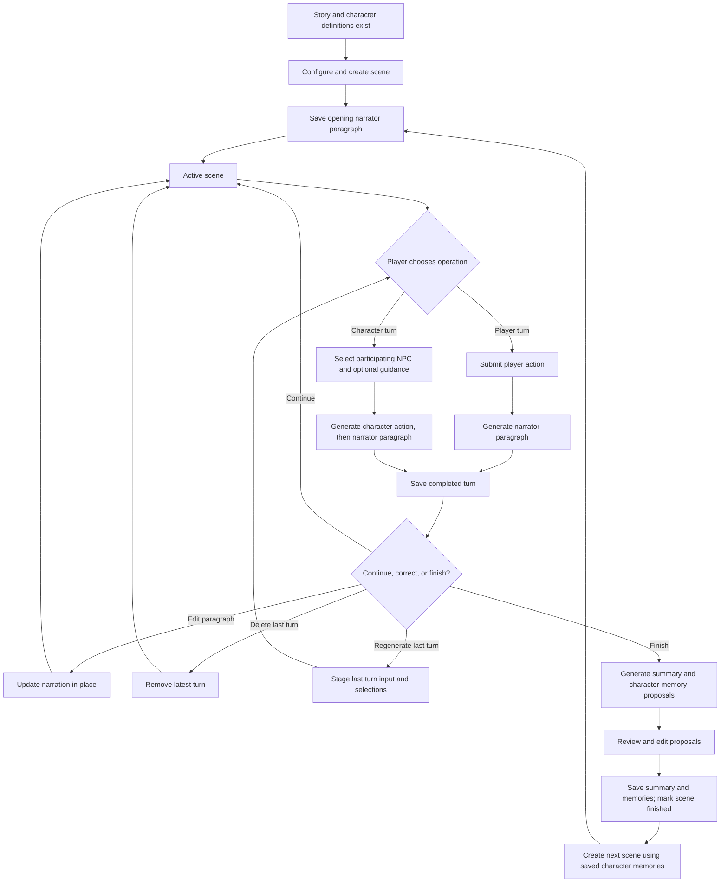
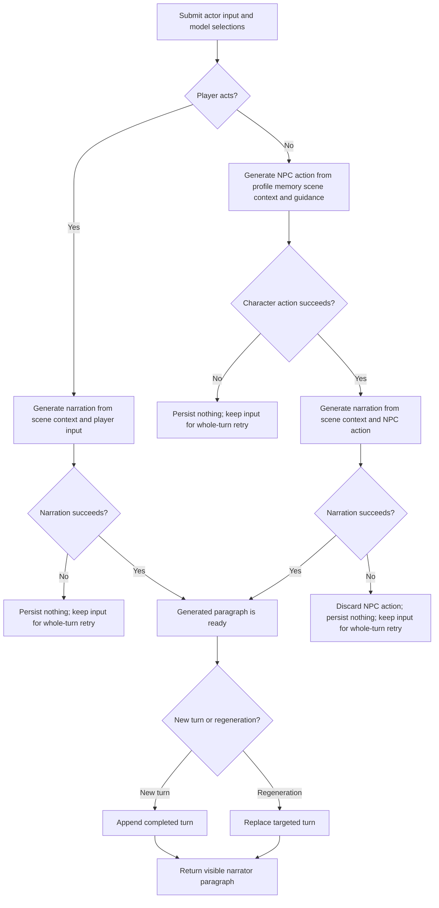

# Character-Driven Story Algorithms

This document defines the algorithms needed for character-driven story play. It describes proposed behavior for the feature; it does not change documentation of currently implemented story types.

## 1. Create a Scene

Validate the player character (which may be absent, shown as the `Narrator` option), NPC participants (no duplicates, none equal to the player character), required scene inputs, and selected agent models. Reject creation while another scene is active. Initialize the scene with its opening narrator paragraph; that item's `llm_data` stores the two models selected at creation.

## 2. Build Agent Context

The character agent receives the character's profile (the `features` field only), its accumulated memories (the root-level `memory` field), the narration of the current scene, and optional player guidance. The narrator receives the scene's `context` as story context, the scene configuration, the narration of the current scene, and the current turn, all in one user message. The character agent's output is passed to the narrator and stored as returned, without parsing.

## 3. Process a Player Turn

Pass the player's action, dialogue, or reaction to the narrator, then store the resulting paragraph and the input needed to correct or replace the turn.

## 4. Process a Character Turn

Generate an action for the selected NPC using its profile, memory, scene context, and optional player guidance. Pass that action to the narrator, then store the action, guidance, and resulting paragraph as one turn.

## 5. Handle Generation Failure and Retry

Retry is whole-turn. If the character call or the narration fails, nothing is persisted and no usage is recorded; the player resubmits the same request, which re-runs both calls, so a retried character action may differ. No intermediate output is retained, so a retry cannot add a duplicate visible turn. Usage records are written only after the completed turn is persisted.

## 6. Edit a Paragraph

Replace the displayed narration for a selected turn without changing its input, generated character action, turn identity, or position in the scene.

## 7. Delete the Last Turn

Remove the latest turn. Remaining turn identifiers are not renumbered, and the next created turn uses the maximum remaining ID plus one. The opening paragraph cannot be deleted. The scene context is unaffected, because narration history is read from the remaining turns.

## 8. Regenerate the Last Turn

Replace the latest turn using its restored input as a starting point, allowing the player to change the actor, text or guidance, and models before submitting. The agents' scene history excludes the replaced turn. Keep the existing paragraph until replacement succeeds. The opening paragraph has no turn input and cannot be regenerated.

## 9. Finish a Scene

Generate a scene summary and a memory update for each participating character (including the player character, if assigned), allow review and edits, then persist the approved results and mark the scene finished. Persistence validates everything first, writes each character's memory, and writes the scene metadata last; if a write fails, the previous memories are restored. Generation uses the configured `SUMMARY_MODEL`.

## 10. Create the Next Scene

Initialize a subsequent scene using the story's characters and their saved memories, while keeping the finished scene unchanged. The creation form pre-fills the context (previous context plus the summary), the writing style and the opening paragraph (the previous scene's last narration), and derives the default models from the previous scene's turns.

## Algorithm Diagrams

### Scene Lifecycle

### Turn Generation and Recovery

